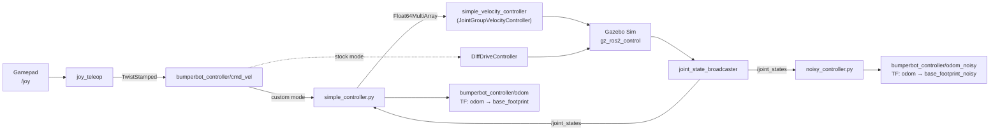

<div align="center">

# 🤖 Bumper_Bot

### A ROS 2 differential-drive robot, built from the URDF up: modelled, simulated, controlled and driven by joystick.


</div>

**Bumperbot** is a small two-wheeled mobile robot. This repository is the complete ROS 2 workspace behind it: the robot's 3D model, its Gazebo simulation, the `ros2_control` drive stack, a **from-scratch Python controller** (differential-drive kinematics and wheel odometry), a **noisy-odometry node** for studying sensor error, and joystick teleoperation.

The goal is to understand a mobile robot's full software stack by building each layer by hand: *describe it → simulate it → command it → measure where it is → see how measurements go wrong.*

---

## 🎬 Demo

<table>
  <tr>
    <td align="center" width="50%">
      <br>
      <b>RViz</b>: robot model and TF frames
    </td>
    <td align="center" width="50%">
      <br>
      <b>Gazebo Sim</b>: physics simulation
    </td>
  </tr>
  <tr>
    <td align="center" width="50%">
      <br>
      <b>Driving with a velocity command</b><br>
      <sub><code>ros2 topic pub</code> on <code>/bumperbot_controller/cmd_vel</code></sub>
    </td>
    <td align="center" width="50%">
      <br>
      <b>Driving with an external joystick</b><br>
      <sub><code>joy</code> → <code>joy_teleop</code> → controller</sub>
    </td>
  </tr>
</table>

<!--
For a full-length video, edit this README on github.com, drag the .mp4 into the editor,
and paste the link GitHub generates on its own line here. GitHub renders it as a video player.
-->

---

## Table of Contents

1. [What We Are Doing Here](#1-what-we-are-doing-here)
2. [Features](#2-features)
3. [Quick Start](#3-quick-start)
4. [Workspace Layout](#4-workspace-layout)
5. [System Architecture](#5-system-architecture)
6. [How It Works](#6-how-it-works)
7. [Package Breakdown](#7-package-breakdown)
8. [The Robot Model](#8-the-robot-model)
9. [Prerequisites](#9-prerequisites)
10. [Build](#10-build)
11. [Run](#11-run)
12. [ROS Interfaces](#12-ros-interfaces)
13. [Configuration Reference](#13-configuration-reference)
14. [Practice Nodes](#14-practice-nodes-bumperbot_py_examples)
15. [Git Workflow](#15-git-workflow-gitsyncsh)
16. [Troubleshooting](#16-troubleshooting)
17. [Roadmap](#17-roadmap)
18. [Acknowledgements and License](#18-acknowledgements-and-license)

---

## 1. What We Are Doing Here

A mobile robot is more than a model that moves. This project builds the stack one layer at a time:

| Step | Question | Where it lives |
| --- | --- | --- |
| **1. Describe** | What does the robot look like, weigh, and how are its joints arranged? | `bumperbot_description`: Xacro/URDF, STL meshes, inertias |
| **2. Simulate** | How does it behave under physics? | Gazebo Sim launch, contact and friction tuning |
| **3. Actuate** | How do wheel commands reach the motors? | `ros2_control` hardware interface, velocity controllers |
| **4. Command** | How do we turn "drive forward at 0.2 m/s, turn at 0.5 rad/s" into wheel speeds? | `simple_controller`: inverse differential-drive kinematics |
| **5. Localise** | Where is the robot, based only on its wheels? | `simple_controller`: wheel odometry, `odom → base_footprint` TF |
| **6. Break it** | What happens when sensors and measurements are imperfect? | `noisy_controller`: noisy encoders and wrong wheel geometry |
| **7. Drive it** | Can a human control it live? | `joy` + `joy_teleop` gamepad teleoperation |

The custom controller is built to be compared against the stock `DiffDriveController` from `ros2_controllers`. Writing the maths by hand shows exactly what that controller does for you.

---

## 2. Features

| Area | What is implemented |
| --- | --- |
| **Modelling** | Xacro URDF with `base_footprint → base_link`, two continuous wheel joints, two fixed casters, inertias, mesh visuals and sphere collisions |
| **Simulation** | Gazebo Sim (`gz_sim`) with an empty world, robot spawned from `/robot_description`, `/clock` bridged to ROS |
| **Hardware abstraction** | `ros2_control` system with velocity command interfaces and position and velocity state interfaces |
| **Custom controller** | `TwistStamped` → left/right wheel velocities (inverse kinematics) and `/joint_states` → `nav_msgs/Odometry` plus TF (forward kinematics) |
| **Stock controller** | `DiffDriveController` with velocity and acceleration limits, covariances and odom TF |
| **Noisy odometry** | Second odometry estimate with Gaussian encoder noise and deliberately wrong wheel radius and separation |
| **Teleoperation** | Gamepad with a deadman button mapped to linear X and angular Z |
| **Distro awareness** | Launch files and Xacro choose Gazebo Sim or Ignition plugins from `$ROS_DISTRO` |
| **Learning nodes** | 7 `rclpy` examples plus custom `AddTwoInts` and `GetTransform` service interfaces |

---

## 3. Quick Start

```bash
# 1. Install dependencies (see section 9 for the full list), then clone and build
git clone https://github.com/DivyomSrivastava/Bumper_Bot.git bumperbot_ws
cd bumperbot_ws
rosdep install --from-paths src --ignore-src -r -y
colcon build
source install/setup.bash

# 2. Terminal 1: simulator
ros2 launch bumperbot_description gazebo.launch.py

# 3. Terminal 2 (source the workspace first): controllers
ros2 launch bumperbot_controller controller.launch.py use_python:=True

# 4. Terminal 3 (source the workspace first): drive it
ros2 launch bumperbot_controller joystick_teleop.launch.py
```

No gamepad? Send a velocity command from the terminal instead:

```bash
ros2 topic pub -r 10 /bumperbot_controller/cmd_vel geometry_msgs/msg/TwistStamped \
  "{twist: {linear: {x: 0.2}, angular: {z: 0.0}}}"
```

---

## 4. Workspace Layout

Only files tracked in Git are shown. `build/`, `install/` and `log/` are produced by `colcon build` and are ignored through `.gitignore`.

```text
bumperbot_ws/
├── README.md
├── gitsync.sh                         # One-command "add, commit and push" helper
├── .gitignore
├── docs/media/                        # Screenshots and demo GIFs used by this README
│
└── src/
    ├── bumperbot_description/         # ── ROBOT MODEL (ament_cmake) ──
    │   ├── launch/
    │   │   ├── display.launch.py      # RViz + robot_state_publisher + joint_state_publisher
    │   │   └── gazebo.launch.py       # Gazebo Sim + robot_state_publisher + spawn + clock bridge
    │   ├── meshes/                    # base_link, wheel_left/right, caster_front/rear, imu_link, can (STL)
    │   ├── rviz/display.rviz          # Saved RViz layout
    │   └── urdf/
    │       ├── bumperbot.urdf.xacro           # Main model (links, joints, inertias)
    │       ├── bumperbot_gazebo.xacro         # Gazebo contact tuning + ros2_control plugin
    │       └── bumperbot_ros2_control.xacro   # ros2_control hardware and joint interfaces
    │
    ├── bumperbot_controller/          # ── DRIVE CONTROL (ament_cmake + Python) ──
    │   ├── bumperbot_controller/
    │   │   ├── simple_controller.py   # Inverse kinematics + wheel odometry + TF
    │   │   └── noisy_controller.py    # Odometry with simulated encoder noise and wrong geometry
    │   ├── config/
    │   │   ├── bumperbot_controllers.yaml  # controller_manager + DiffDrive + velocity controller
    │   │   ├── joy_config.yaml             # joy_node parameters
    │   │   └── joy_teleop.yaml             # Gamepad → TwistStamped mapping
    │   └── launch/
    │       ├── controller.launch.py        # Spawns controllers, custom or stock, plus noisy odometry
    │       └── joystick_teleop.launch.py   # joy_node + joy_teleop
    │
    ├── bumperbot_msgs/                # ── CUSTOM INTERFACES (ament_cmake + rosidl) ──
    │   └── srv/AddTwoInts.srv, GetTransform.srv
    │
    ├── bumperbot_py_examples/         # ── rclpy PRACTICE NODES (ament_python) ──
    │   └── bumperbot_py_examples/
    │       ├── simple_publisher.py            ├── simple_subscriber.py
    │       ├── simple_parameter.py            ├── simple_service_server.py
    │       ├── simple_service_client.py       ├── simple_tf_kinematics.py
    │       └── simple_turtlesim_kinematics.py
    │
    └── bumperbot_cpp_examples/        # ── rclcpp SCAFFOLD (ament_cmake, no sources yet) ──
```

---

## 5. System Architecture

### Data flow



### TF tree

```text
odom
 ├── base_footprint            (simple_controller, or DiffDriveController in stock mode)
 │    └── base_link            (fixed, z = 0.033 m)
 │         ├── wheel_left_link     (continuous, y = +0.0701 m)
 │         ├── wheel_right_link    (continuous, y = −0.0701 m)
 │         ├── caster_front_link   (fixed, x = +0.04755 m, z = −0.0275 m)
 │         └── caster_rear_link    (fixed, x = −0.04755 m, z = −0.0275 m)
 │
 └── base_footprint_noisy      (noisy_controller: the drifting estimate, for comparison)
```

---

## 6. How It Works

### 6.1 Differential-drive kinematics

For wheel radius **r**, wheel separation **L**, and left/right wheel angular velocities **ω<sub>L</sub>**, **ω<sub>R</sub>**:

```text
v = r/2 · (ω_R + ω_L)        # linear velocity   [m/s]
ω = r/L · (ω_R − ω_L)        # angular velocity  [rad/s]
```

In matrix form:

```text
┌ v ┐   ┌  r/2    r/2 ┐ ┌ ω_R ┐
│   │ = │             │ │     │
└ ω ┘   └  r/L   −r/L ┘ └ ω_L ┘
```

`simple_controller` builds this matrix once. For every velocity command it solves `[ω_R, ω_L] = M⁻¹ · [v, ω]` and publishes the result in joint order `[left, right]`.

### 6.2 Two controller modes

| Mode | Launch argument | How it drives the wheels |
| --- | --- | --- |
| **Custom** (default) | `use_simple_controller:=True` | `simple_controller` → `simple_velocity_controller/commands` → `JointGroupVelocityController` |
| **Stock** | `use_simple_controller:=False` | `DiffDriveController` with limits, odometry and TF |

Both read commands from `bumperbot_controller/cmd_vel` (`TwistStamped`).

> ℹ️ `controller.launch.py` runs the Python nodes only when `use_python:=True`. With the default (`use_python:=False`) it looks for C++ executables that this workspace does not contain, so always pass `use_python:=True`.

Stock controller limits (from `bumperbot_controllers.yaml`):

| Axis | Max velocity | Min velocity | Max acceleration | Min acceleration |
| --- | --- | --- | --- | --- |
| Linear X | 1.0 m/s | −0.5 m/s | 0.8 m/s² | −0.4 m/s² |
| Angular Z | 1.7 rad/s | −1.7 rad/s (default) | 1.5 rad/s² | −1.5 rad/s² (default) |

Other stock settings: `cmd_vel_timeout = 0.5 s`, `publish_rate = 50 Hz`, `base_frame_id = base_footprint`, `use_stamped_vel = true`, `enable_odom_tf = true`.

### 6.3 Wheel odometry (`simple_controller`)

The same maths runs backwards to estimate where the robot is. On every `/joint_states` message:

1. The first message only sets the baseline (previous wheel positions and timestamp). Messages with fewer than two positions, or with `dt ≤ 0`, are skipped.
2. It computes the wheel position changes `Δφ_L`, `Δφ_R`, and the wheel speeds `Δφ / dt`.
3. It derives the robot velocities and integrates the pose:

```text
v  = r/2 · (ω_R + ω_L)         Δs = r/2 · (Δφ_R + Δφ_L)
ω  = r/L · (ω_R − ω_L)         Δθ = r/L · (Δφ_R − Δφ_L)

θ ← θ + Δθ
x ← x + Δs · cos θ
y ← y + Δs · sin θ
```

4. It converts `θ` to a quaternion (`tf_transformations`) and publishes `nav_msgs/Odometry` on `bumperbot_controller/odom` (frame `odom`, child `base_footprint`) with the matching TF.

The node reads `joint_states[0]` as the left wheel and `[1]` as the right wheel, so it relies on the joint order from `joint_state_broadcaster` (`wheel_left_joint`, `wheel_right_joint`).

### 6.4 Noisy odometry (`noisy_controller`)

Real wheel odometry is never perfect. `noisy_controller` runs the same odometry maths as above, but corrupts its inputs on purpose:

| Imperfection | How it is simulated | Default |
| --- | --- | --- |
| **Encoder noise** | Gaussian noise added to every wheel position reading | σ = 0.005 rad |
| **Wrong wheel radius** | `wheel_radius + wheel_radius_error` | 0.033 + 0.005 m |
| **Wrong wheel separation** | `wheel_separation + wheel_separation_error` | 0.17 + 0.02 m |

The result is published on `bumperbot_controller/odom_noisy` and as the TF frame `base_footprint_noisy`, next to the cleaner `simple_controller` estimate. Drive the robot and the two estimates drift apart, which shows how small measurement and calibration errors accumulate. It is also a test input for sensor fusion (see the [roadmap](#17-roadmap)).

The error sizes are launch arguments:

```bash
ros2 launch bumperbot_controller controller.launch.py use_python:=True \
  wheel_radius_error:=0.01 wheel_separation_error:=0.03
```

**Try it:** open RViz, set the fixed frame to `odom`, add the TF display and two `Odometry` displays (`odom` and `odom_noisy`), then drive in a loop.

---

## 7. Package Breakdown

### `bumperbot_description`: what the robot *is*

| File | Role |
| --- | --- |
| `urdf/bumperbot.urdf.xacro` | Main model. Declares `is_ignition`, includes the helper Xacro files, defines all links, joints, masses and inertia tensors. |
| `urdf/bumperbot_gazebo.xacro` | Gazebo contact tuning (`mu1`, `mu2`, `kp`, `kd`, ...) per link, plus the `ros2_control` plugin loading `bumperbot_controllers.yaml`. Picks `gz_ros2_control` or `ign_ros2_control` through `is_ignition`. |
| `urdf/bumperbot_ros2_control.xacro` | `ros2_control` system. Both wheel joints get a `velocity` command interface (min −1, max 1) and `position` and `velocity` state interfaces. |
| `launch/display.launch.py` | Runs `xacro`, starts `robot_state_publisher`, `joint_state_publisher` and `rviz2`. Accepts `model:=`. |
| `launch/gazebo.launch.py` | Runs `xacro` with the right `is_ignition` value, sets `GZ_SIM_RESOURCE_PATH`, starts Gazebo Sim (`-v 4 -r empty.sdf`), spawns the robot and bridges `/clock`. |
| `meshes/*.STL` | Visual meshes. Collisions use simple spheres (wheels r = 0.033 m, casters r = 0.005 m) for fast, stable physics. |

### `bumperbot_controller`: how the robot *moves*

| File | Role |
| --- | --- |
| `simple_controller.py` | Custom controller: command → wheel speeds, and wheel odometry ([6.1](#61-differential-drive-kinematics), [6.3](#63-wheel-odometry-simple_controller)). |
| `noisy_controller.py` | Odometry with simulated encoder noise and geometry errors ([6.4](#64-noisy-odometry-noisy_controller)). |
| `config/bumperbot_controllers.yaml` | Controller manager at 100 Hz; registers `bumperbot_controller` (DiffDrive), `joint_state_broadcaster` and `simple_velocity_controller`. |
| `config/joy_config.yaml`, `joy_teleop.yaml` | Gamepad settings and the gamepad → `TwistStamped` mapping. |
| `launch/controller.launch.py` | Spawns the broadcaster and the chosen controller, and always starts the noisy odometry node. |
| `launch/joystick_teleop.launch.py` | Starts `joy_node` and `joy_teleop`. |

### `bumperbot_msgs`, `bumperbot_py_examples`, `bumperbot_cpp_examples`

- `bumperbot_msgs`: `AddTwoInts.srv` (`int64 a, b → int64 sum`) and `GetTransform.srv` (`frame_id, child_frame_id → TransformStamped, bool success`).
- `bumperbot_py_examples`: small `rclpy` nodes covering core ROS 2 concepts ([section 14](#14-practice-nodes-bumperbot_py_examples)).
- `bumperbot_cpp_examples`: an `ament_cmake` scaffold for future `rclcpp` nodes. It builds but has no sources yet.

---

## 8. The Robot Model

| Link | Parent joint | Type | Origin relative to parent |
| --- | --- | --- | --- |
| `base_footprint` | none (root) | n/a | n/a |
| `base_link` | `base_joint` | fixed | z = 0.033 m |
| `wheel_right_link` | `wheel_right_joint` | continuous (axis Y) | y = −0.0701 m |
| `wheel_left_link` | `wheel_left_joint` | continuous (axis Y) | y = +0.0701 m |
| `caster_front_link` | `caster_front_joint` | fixed | x = +0.04755 m, z = −0.0275 m |
| `caster_rear_link` | `caster_rear_joint` | fixed | x = −0.04755 m, z = −0.0275 m |

| Parameter | Value |
| --- | --- |
| Chassis mass | ≈ 0.826 kg |
| Wheel mass (each) | ≈ 0.053 kg |
| Wheel radius | 0.033 m |
| Wheel separation | 0.17 m in the controller config (URDF wheel joints sit ≈ 0.1402 m apart, see the note below) |
| Wheel friction (Gazebo) | `mu1 = mu2 = 1e14` (effectively no slip) |
| Caster friction (Gazebo) | `mu1 = mu2 = 0.1` (casters slide freely) |

> ⚠️ The URDF wheel joints are about 0.1402 m apart, while the controllers use `wheel_separation = 0.17`. This is a built-in geometry error in the *ideal* odometry too. If odometry drifts in turns, compare these two numbers first.

---

## 9. Prerequisites

- Ubuntu **24.04** with **ROS 2 Jazzy** (desktop install)
- `colcon`, `rosdep`, `git`

```bash
sudo apt update
sudo apt install -y \
  ros-jazzy-ros2-control ros-jazzy-ros2-controllers \
  ros-jazzy-ros-gz ros-jazzy-gz-ros2-control \
  ros-jazzy-xacro ros-jazzy-robot-state-publisher ros-jazzy-joint-state-publisher \
  ros-jazzy-rviz2 ros-jazzy-joy ros-jazzy-joy-teleop \
  ros-jazzy-tf-transformations python3-transforms3d \
  ros-jazzy-turtlesim python3-numpy libeigen3-dev
```

`tf_transformations` (with `transforms3d`) is needed for the quaternion conversion in both controller nodes.

---

## 10. Build

```bash
git clone https://github.com/DivyomSrivastava/Bumper_Bot.git bumperbot_ws
cd bumperbot_ws
rosdep install --from-paths src --ignore-src -r -y
colcon build
source install/setup.bash
```

> 💡 Always run `colcon build` from the **workspace root**, not from inside `src/`. Running it in `src/` creates stray `src/build`, `src/install` and `src/log` folders.

---

## 11. Run

Every terminal needs `source install/setup.bash` first.

| Goal | Command |
| --- | --- |
| View the model in RViz | `ros2 launch bumperbot_description display.launch.py` |
| Simulate in Gazebo | `ros2 launch bumperbot_description gazebo.launch.py` |
| Start the custom controller | `ros2 launch bumperbot_controller controller.launch.py use_python:=True` |
| Start the stock controller | `ros2 launch bumperbot_controller controller.launch.py use_simple_controller:=False` |
| Drive with a gamepad | `ros2 launch bumperbot_controller joystick_teleop.launch.py` |
| Watch odometry | `ros2 topic echo /bumperbot_controller/odom` |
| Watch the noisy odometry | `ros2 topic echo /bumperbot_controller/odom_noisy` |
| Inspect the TF tree | `ros2 run tf2_tools view_frames` |

**Typical full session:**

| Terminal | Command |
| --- | --- |
| 1 | `ros2 launch bumperbot_description gazebo.launch.py` |
| 2 | `ros2 launch bumperbot_controller controller.launch.py use_python:=True` |
| 3 | `ros2 launch bumperbot_controller joystick_teleop.launch.py` |

**Gamepad:** hold the deadman button (index 5), then use axis 1 for forward/back and axis 3 for turning.

---

## 12. ROS Interfaces

| Name | Type | Direction | Provided by |
| --- | --- | --- | --- |
| `bumperbot_controller/cmd_vel` | `geometry_msgs/TwistStamped` | in | `joy_teleop`, CLI, or any node |
| `bumperbot_controller/odom` | `nav_msgs/Odometry` | out | `simple_controller` |
| `bumperbot_controller/odom_noisy` | `nav_msgs/Odometry` | out | `noisy_controller` |
| `simple_velocity_controller/commands` | `std_msgs/Float64MultiArray` | out | `simple_controller` → `JointGroupVelocityController` |
| `/joint_states` | `sensor_msgs/JointState` | out | `joint_state_broadcaster` |
| `/robot_description` | `std_msgs/String` | out | `robot_state_publisher` |
| `/tf`, `/tf_static` | `tf2_msgs/TFMessage` | out | `robot_state_publisher`, controllers |
| `/clock` | `rosgraph_msgs/Clock` | out | Gazebo, through `ros_gz_bridge` |
| `/joy` | `sensor_msgs/Joy` | out | `joy_node` |
| `add_two_ints` | `bumperbot_msgs/srv/AddTwoInts` | service | `simple_service_server` |
| `get_transform` | `bumperbot_msgs/srv/GetTransform` | service | `simple_tf_kinematics` |
| `chatter` | `std_msgs/String` | pub/sub | `simple_publisher` / `simple_subscriber` |

---

## 13. Configuration Reference

### `controller.launch.py` arguments

| Argument | Default | Meaning |
| --- | --- | --- |
| `use_sim_time` | `True` | Use the Gazebo clock |
| `use_simple_controller` | `True` | `True` = custom velocity controller, `False` = stock `DiffDriveController` |
| `use_python` | `False` | Run the Python nodes (`simple_controller.py`, `noisy_controller.py`) instead of C++ executables |
| `wheel_radius` | `0.033` | Wheel radius in metres |
| `wheel_separation` | `0.17` | Distance between wheels in metres |
| `wheel_radius_error` | `0.005` | Radius error added for the noisy odometry |
| `wheel_separation_error` | `0.02` | Separation error added for the noisy odometry |

### Joystick

| Setting | File | Value |
| --- | --- | --- |
| Device | `joy_config.yaml` | `device_id: 0` |
| Deadzone | `joy_config.yaml` | `0.1` |
| Autorepeat | `joy_config.yaml` | `20 Hz` |
| Deadman button | `joy_teleop.yaml` | button `5` (must be held) |
| Forward/back | `joy_teleop.yaml` | axis `1`, scale `1.0` |
| Turning | `joy_teleop.yaml` | axis `3`, scale `8.0` |

Button and axis numbers depend on your gamepad. Check yours with `ros2 topic echo /joy`.

---

## 14. Practice Nodes (`bumperbot_py_examples`)

| Executable | Concept |
| --- | --- |
| `simple_publisher` | Publisher with a timer (`String` on `/chatter` at 1 Hz) |
| `simple_subscriber` | Subscriber callback |
| `simple_parameter` | Parameter declaration and validation (`simple_int_param` ≥ 0, `simple_string_param` ≤ 20 chars) |
| `simple_service_server` | Service server (`add_two_ints`) |
| `simple_service_client` | Async service client: `ros2 run bumperbot_py_examples simple_service_client 3 4` |
| `simple_tf_kinematics` | Static and dynamic TF (`odom → bumperbot_base → bumperbot_top`) plus a `get_transform` service |
| `simple_turtlesim_kinematics` | Relative translation and rotation between two turtles |

Run any of them with `ros2 run bumperbot_py_examples <executable>`. For the turtlesim example, spawn a second turtle first:

```bash
ros2 run turtlesim turtlesim_node
ros2 service call /spawn turtlesim/srv/Spawn "{x: 2.0, y: 2.0, theta: 0.0, name: 'turtle2'}"
```

---

## 15. Git Workflow (`gitsync.sh`)

`gitsync.sh` stages everything, commits, and pushes the current branch in one step. It runs from the workspace folder it lives in:

```bash
./gitsync.sh "added joystick teleop launch file"   # custom message
./gitsync.sh                                        # timestamped message
```

If the tree is clean it prints `Nothing new to commit.` and still pushes. Generated folders (`build/`, `install/`, `log/`) are excluded by `.gitignore`.

---

## 16. Troubleshooting

| Symptom | Likely cause and fix |
| --- | --- |
| `executable 'simple_controller'` (or `'noisy_controller'`) `not found` | The default launch looks for C++ executables that do not exist. Add `use_python:=True`. |
| `ModuleNotFoundError: tf_transformations` | `sudo apt install ros-jazzy-tf-transformations python3-transforms3d` |
| `rosdep` fails on the key `sys` | `bumperbot_py_examples/package.xml` lists `<exec_depend>sys</exec_depend>`. `sys` is part of Python and is not a rosdep key; delete that line. |
| Robot invisible or meshes missing in Gazebo | Source the workspace before launching so `GZ_SIM_RESOURCE_PATH` resolves. |
| Robot does not move in Gazebo | Controllers are not running. Start `controller.launch.py` and check `ros2 control list_controllers`. |
| Gamepad does nothing | Hold the deadman button (index 5) and verify axis and button numbers with `ros2 topic echo /joy`. |
| Odometry drifts in turns | Check that `wheel_separation` and `wheel_radius` match the model (see the note in [section 8](#8-the-robot-model)). |
| Robot is very slow in Gazebo | `bumperbot_ros2_control.xacro` limits each wheel velocity command to ±1. Raise `min`/`max` if the wheels cannot reach the speeds you command. |
| `odom_noisy` header says `base_footprint_ekf`, TF says `base_footprint_noisy` | Known naming mismatch in `noisy_controller.py` (the message uses `base_footprint_ekf` as its child frame, the TF uses `base_footprint_noisy`). Use the TF frame for visualisation. |
| Stray `src/build`, `src/install`, `src/log` | `colcon build` was run inside `src/`. Delete them and build from the workspace root. |
| `git push` asks for a password | GitHub no longer accepts account passwords. Use a personal access token (Contents: read and write), `gh auth login`, or an SSH key. |

---

## 17. Roadmap

- [x] URDF/Xacro model with meshes, inertias and collisions
- [x] Gazebo Sim simulation with `ros2_control`
- [x] Custom differential-drive controller with wheel odometry
- [x] Joystick teleoperation
- [x] Noisy odometry for error studies
- [ ] Fuse wheel odometry with an IMU using an EKF (`robot_localization`); the `imu_link` mesh exists but is not yet attached to the URDF
- [ ] Add a LiDAR and run SLAM (`slam_toolbox`)
- [ ] Autonomous navigation with Nav2
- [ ] Port the controllers to C++ in `bumperbot_cpp_examples`, so `use_python:=False` works
- [ ] Reconcile the URDF wheel separation (≈ 0.1402 m) with the controller value (0.17 m)
- [ ] Add a `LICENSE` file and fill in the `TODO` licence fields in the package manifests

---

## 18. Acknowledgements and License

Workspace built and maintained by **[Divyom Srivastava](https://github.com/DivyomSrivastava)**, B.Tech student at PSIT Kanpur, working towards a career in robotics.

Parts of the package structure and several nodes follow the ROS 2 learning material by **Antonio Brandi**, who is credited as author in the `bumperbot_controller` `package.xml`.

The `bumperbot_controller` package is declared Apache-2.0 in its `package.xml`. The other packages still contain `TODO` license declarations; add a `LICENSE` file before redistributing.

<div align="center">

⭐ If this workspace helped you, consider starring the repo.

</div>
