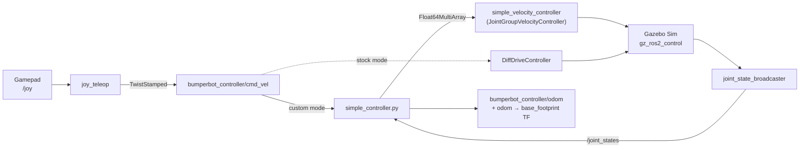

<div align="center">

# 🤖 Bumper_Bot

**A ROS 2 Jazzy workspace for a differential-drive mobile robot: URDF/Xacro model, Gazebo Sim simulation, `ros2_control` drive stack, joystick teleoperation, and a from-scratch Python kinematics + odometry controller.**


</div>

---

## Table of Contents

1. [Overview](#1-overview)
2. [Features](#2-features)
3. [Quick Start](#3-quick-start)
4. [Workspace Layout](#4-workspace-layout)
5. [System Architecture](#5-system-architecture)
6. [Package Breakdown](#6-package-breakdown)
7. [The Robot Model](#7-the-robot-model)
8. [Controllers and Kinematics](#8-controllers-and-kinematics)
9. [Prerequisites](#9-prerequisites)
10. [Build](#10-build)
11. [Run](#11-run)
12. [ROS Interfaces](#12-ros-interfaces)
13. [Configuration Reference](#13-configuration-reference)
14. [Practice Nodes](#14-practice-nodes-bumperbot_py_examples)
15. [Git Workflow](#15-git-workflow-gitsyncsh)
16. [Troubleshooting](#16-troubleshooting)
17. [Possible Next Steps](#17-possible-next-steps)
18. [Acknowledgements and License](#18-acknowledgements-and-license)

---

## 1. Overview

**Bumperbot** is a small two-wheeled, differential-drive robot with two passive casters. This workspace contains everything needed to model it, simulate it and drive it:

- A **URDF/Xacro** description with STL meshes, inertial properties and collision geometry.
- A **Gazebo Sim** launch setup that spawns the robot into an empty world.
- A **`ros2_control`** hardware interface exposing both wheel joints as velocity-controlled joints.
- **Two interchangeable drive controllers:**
  - a custom Python node (`simple_controller`) that does inverse kinematics (velocity command → wheel speeds) and forward kinematics (wheel encoders → odometry and the `odom → base_footprint` TF);
  - the stock `diff_drive_controller/DiffDriveController`.
- **Joystick teleoperation** through `joy` and `joy_teleop`.
- A set of **`rclpy` practice nodes** (pub/sub, parameters, services, TF, turtlesim kinematics) and two custom service interfaces.

The workspace targets **ROS 2 Jazzy** on **Ubuntu 24.04**. The launch files also detect `humble` and switch to the Ignition plugins automatically.

<!--
Add a screenshot or GIF of the robot here once you have one, for example:

-->

---

## 2. Features

| Area | What is implemented |
| --- | --- |
| **Modelling** | Xacro URDF with `base_footprint → base_link`, two continuous wheel joints, two fixed casters, inertias, mesh visuals and simple sphere collisions |
| **Simulation** | Gazebo Sim (`gz_sim`) launch with `-r empty.sdf`, robot spawned from `/robot_description`, `/clock` bridged to ROS |
| **Hardware abstraction** | `ros2_control` system with velocity command interfaces (clamped to ±1) and position and velocity state interfaces |
| **Custom controller** | Python node converting `TwistStamped` into left/right wheel velocities (inverse differential-drive matrix) **and** integrating wheel positions from `/joint_states` into `nav_msgs/Odometry` plus TF |
| **Stock controller** | `DiffDriveController` with velocity and acceleration limits, covariance settings, odometry and odom TF |
| **Teleop** | Gamepad with a deadman button, mapped to linear X and angular Z |
| **Distro awareness** | Launch files and Xacro choose Gazebo Sim or Ignition plugins from `$ROS_DISTRO` |
| **Learning nodes** | 7 `rclpy` examples plus custom `AddTwoInts` and `GetTransform` service interfaces |

---

## 3. Quick Start

```bash
# 1. Clone and build
git clone https://github.com/DivyomSrivastava/Bumper_Bot.git bumperbot_ws
cd bumperbot_ws
rosdep install --from-paths src --ignore-src -r -y
colcon build
source install/setup.bash

# 2. Terminal 1: simulator
ros2 launch bumperbot_description gazebo.launch.py

# 3. Terminal 2 (source the workspace first): controllers
ros2 launch bumperbot_controller controller.launch.py use_python:=True

# 4. Terminal 3 (source the workspace first): drive with a gamepad
ros2 launch bumperbot_controller joystick_teleop.launch.py
```

Full prerequisites are in [section 9](#9-prerequisites).

---

## 4. Workspace Layout

Only files tracked in Git are shown. `build/`, `install/` and `log/` are produced by `colcon build` and are ignored through `.gitignore`.

```text
bumperbot_ws/
├── .gitignore                         # Ignores colcon output, Python caches and the 1 GB+ VS Code IntelliSense cache
├── README.md                          # This file
├── gitsync.sh                         # One-command "add, commit and push" helper
├── .vscode/                           # Editor settings (machine-specific paths)
│
└── src/
    ├── bumperbot_description/         # ── ROBOT MODEL (ament_cmake) ──
    │   ├── launch/
    │   │   ├── display.launch.py      # RViz + robot_state_publisher + joint_state_publisher
    │   │   └── gazebo.launch.py       # Gazebo Sim + robot_state_publisher + entity spawn + clock bridge
    │   ├── meshes/                    # base_link, wheel_left/right, caster_front/rear, imu_link, can (STL)
    │   ├── rviz/display.rviz          # Saved RViz layout
    │   └── urdf/
    │       ├── bumperbot.urdf.xacro           # Main model (links, joints, inertias)
    │       ├── bumperbot_gazebo.xacro         # Gazebo contact tuning + ros2_control plugin
    │       └── bumperbot_ros2_control.xacro   # ros2_control hardware and joint interfaces
    │
    ├── bumperbot_controller/          # ── DRIVE CONTROL (ament_cmake + Python) ──
    │   ├── bumperbot_controller/
    │   │   ├── simple_controller.py   # Custom node: inverse kinematics + wheel odometry + TF
    │   │   └── noisy_controller.py    # Additional controller node (added in the latest update)
    │   ├── config/
    │   │   ├── bumperbot_controllers.yaml  # controller_manager + DiffDrive + velocity controller
    │   │   ├── joy_config.yaml             # joy_node parameters
    │   │   └── joy_teleop.yaml             # Gamepad → TwistStamped mapping
    │   └── launch/
    │       ├── controller.launch.py        # Spawns controllers, selects custom or stock
    │       └── joystick_teleop.launch.py   # joy_node + joy_teleop
    │
    ├── bumperbot_msgs/                # ── CUSTOM INTERFACES (ament_cmake + rosidl) ──
    │   └── srv/
    │       ├── AddTwoInts.srv         # int64 a, b → int64 sum
    │       └── GetTransform.srv       # frame_id, child_frame_id → TransformStamped + success
    │
    ├── bumperbot_py_examples/         # ── rclpy PRACTICE NODES (ament_python) ──
    │   ├── setup.py                   # Console-script entry points
    │   └── bumperbot_py_examples/
    │       ├── simple_publisher.py            # Publishes String on /chatter at 1 Hz
    │       ├── simple_subscriber.py           # Subscribes to /chatter
    │       ├── simple_parameter.py            # Parameters with validation callback
    │       ├── simple_service_server.py       # add_two_ints server
    │       ├── simple_service_client.py       # add_two_ints client (CLI args)
    │       ├── simple_tf_kinematics.py        # Static + dynamic TF + get_transform service
    │       └── simple_turtlesim_kinematics.py # Relative pose of turtle2 w.r.t. turtle1
    │
    └── bumperbot_cpp_examples/        # ── rclcpp SCAFFOLD (ament_cmake, no sources yet) ──
```

---

## 5. System Architecture

### Data flow



### TF tree

```text
odom
 └── base_footprint            (published by DiffDriveController when enable_odom_tf = true,
      │                          or by simple_controller when the custom controller runs)
      └── base_link            (fixed, z = 0.033 m)
           ├── wheel_left_link     (continuous, y = +0.0701 m)
           ├── wheel_right_link    (continuous, y = −0.0701 m)
           ├── caster_front_link   (fixed, x = +0.04755 m, z = −0.0275 m)
           └── caster_rear_link    (fixed, x = −0.04755 m, z = −0.0275 m)
```

---

## 6. Package Breakdown

### 6.1 `bumperbot_description`: what the robot *is*

| File | Role |
| --- | --- |
| `urdf/bumperbot.urdf.xacro` | Main model. Declares the `is_ignition` argument and includes the two helper Xacro files. Defines all links, joints, masses and inertia tensors. |
| `urdf/bumperbot_gazebo.xacro` | Gazebo contact tuning (`mu1`, `mu2`, `kp`, `kd`, `minDepth`, `maxVel`) per link, plus the `ros2_control` plugin that loads `bumperbot_controllers.yaml`. Selects `gz_ros2_control` or `ign_ros2_control` through `is_ignition`. |
| `urdf/bumperbot_ros2_control.xacro` | `ros2_control` system description. Both wheel joints get a `velocity` command interface (min −1, max 1) and `position` and `velocity` state interfaces. |
| `launch/display.launch.py` | Runs `xacro`, starts `robot_state_publisher`, `joint_state_publisher` and `rviz2`. Accepts a `model:=` argument. |
| `launch/gazebo.launch.py` | Runs `xacro` with the right `is_ignition` value, sets `GZ_SIM_RESOURCE_PATH` so meshes resolve, starts Gazebo Sim (`-v 4 -r empty.sdf`), spawns the robot as `bumperbot` and bridges `/clock`. |
| `meshes/*.STL` | Visual meshes. Collision uses simple spheres (wheels r = 0.033 m, casters r = 0.005 m) for fast, stable physics. |

### 6.2 `bumperbot_controller`: how the robot *moves*

| File | Role |
| --- | --- |
| `bumperbot_controller/simple_controller.py` | Custom node implementing the differential-drive kinematic model and wheel odometry ([section 8](#8-controllers-and-kinematics)). |
| `bumperbot_controller/noisy_controller.py` | Additional controller node added in the latest update. |
| `config/bumperbot_controllers.yaml` | Controller manager at 100 Hz. Registers `bumperbot_controller` (DiffDrive), `joint_state_broadcaster` and `simple_velocity_controller`, with all their parameters. |
| `config/joy_config.yaml` | `joy_node` settings: device 0, deadzone 0.5, autorepeat 20 Hz. |
| `config/joy_teleop.yaml` | Maps joystick axes and a deadman button (button 6) to `TwistStamped` commands. |
| `launch/controller.launch.py` | Spawns the broadcaster and the chosen controller ([section 13](#13-configuration-reference)). |
| `launch/joystick_teleop.launch.py` | Starts `joy_node` and `joy_teleop` with the YAML configs above. |

### 6.3 `bumperbot_msgs`: custom interfaces

Generated with `rosidl_default_generators`.

- `AddTwoInts.srv`: `int64 a`, `int64 b` → `int64 sum`, for the basic service examples.
- `GetTransform.srv`: `frame_id`, `child_frame_id` → `geometry_msgs/TransformStamped transform`, `bool success`. Used by `simple_tf_kinematics` to expose TF lookups as a service.

### 6.4 `bumperbot_py_examples` and `bumperbot_cpp_examples`

`bumperbot_py_examples` is an `ament_python` package of small, focused `rclpy` nodes ([section 14](#14-practice-nodes-bumperbot_py_examples)). `bumperbot_cpp_examples` is an `ament_cmake` scaffold ready for `rclcpp` nodes; it builds but has no source files yet.

---

## 7. The Robot Model

### 7.1 Links and joints

| Link | Parent joint | Type | Origin relative to parent |
| --- | --- | --- | --- |
| `base_footprint` | none (root) | n/a | n/a |
| `base_link` | `base_joint` | fixed | z = 0.033 m |
| `wheel_right_link` | `wheel_right_joint` | continuous (axis Y) | y = −0.0701 m |
| `wheel_left_link` | `wheel_left_joint` | continuous (axis Y) | y = +0.0701 m |
| `caster_front_link` | `caster_front_joint` | fixed | x = +0.04755 m, z = −0.0275 m |
| `caster_rear_link` | `caster_rear_joint` | fixed | x = −0.04755 m, z = −0.0275 m |

### 7.2 Key physical parameters

| Parameter | Value |
| --- | --- |
| Chassis mass | ≈ 0.826 kg |
| Wheel mass (each) | ≈ 0.053 kg |
| Wheel radius | 0.033 m |
| Wheel separation | 0.17 m in the controller config (the URDF wheel joints sit ≈ 0.1402 m apart, see the note below) |
| Wheel friction (Gazebo) | `mu1 = mu2 = 1e14` (effectively no slip) |
| Caster friction (Gazebo) | `mu1 = mu2 = 0.1` (casters slide freely) |

> ⚠️ The URDF wheel joints are about 0.1402 m apart, while the controllers are configured with `wheel_separation = 0.17`. If odometry drifts in turns, compare these two numbers first.

---

## 8. Controllers and Kinematics

### 8.1 Differential-drive model

For wheel radius **r**, wheel separation **L**, and left/right wheel angular velocities **ω<sub>L</sub>**, **ω<sub>R</sub>**:

```text
v = r/2 · (ω_R + ω_L)        # linear velocity   [m/s]
ω = r/L · (ω_R − ω_L)        # angular velocity  [rad/s]
```

In matrix form:

```text
┌ v ┐   ┌  r/2    r/2 ┐ ┌ ω_R ┐
│   │ = │             │ │     │
└ ω ┘   └  r/L   −r/L ┘ └ ω_L ┘
```

`simple_controller.py` builds this matrix once. For every incoming command it computes `[ω_R, ω_L] = M⁻¹ · [v, ω]` and publishes the result in joint order `[left, right]`.

### 8.2 Controller modes

| Mode | Launch argument | Command topic | How it drives the wheels |
| --- | --- | --- | --- |
| **Custom** (default) | `use_simple_controller:=True` | `bumperbot_controller/cmd_vel` (`TwistStamped`) | `simple_controller` → `simple_velocity_controller/commands` → `JointGroupVelocityController` |
| **Stock** | `use_simple_controller:=False` | `bumperbot_controller/cmd_vel` (`TwistStamped`) | `DiffDriveController` with limits, odometry and TF |

> ℹ️ `controller.launch.py` starts the Python node only when `use_python:=True`. With the default (`use_python:=False`) it looks for a C++ executable called `simple_controller`, which this workspace does not contain. Always pass `use_python:=True` for the custom mode.

Stock controller limits (from `bumperbot_controllers.yaml`):

| Axis | Max velocity | Min velocity | Max acceleration | Min acceleration |
| --- | --- | --- | --- | --- |
| Linear X | 1.0 m/s | −0.5 m/s | 0.8 m/s² | −0.4 m/s² |
| Angular Z | 1.7 rad/s | −1.7 rad/s (default) | 1.5 rad/s² | −1.5 rad/s² (default) |

Other stock settings: `cmd_vel_timeout = 0.5 s`, `publish_rate = 50 Hz`, `base_frame_id = base_footprint`, `use_stamped_vel = true`, `enable_odom_tf = true`, `publish_limited_velocity = true`.

### 8.3 Wheel odometry in `simple_controller`

Besides converting commands, the node estimates the robot pose from the wheel encoders:

1. It subscribes to `/joint_states` and reads the left wheel from `position[0]` and the right wheel from `position[1]`.
2. For each new message it computes the wheel position changes `Δφ_L`, `Δφ_R` and the wheel speeds `Δφ / dt`.
3. It derives the robot velocities and the pose increment:

```text
v  = r/2 · (ω_R + ω_L)         Δs = r/2 · (Δφ_R + Δφ_L)
ω  = r/L · (ω_R − ω_L)         Δθ = r/L · (Δφ_R − Δφ_L)

θ ← θ + Δθ
x ← x + Δs · cos θ
y ← y + Δs · sin θ
```

4. It converts `θ` to a quaternion with `tf_transformations` and publishes a `nav_msgs/Odometry` message on `bumperbot_controller/odom` (frame `odom`, child frame `base_footprint`) together with the matching `odom → base_footprint` transform.

Because the node reads `joint_states[0]` as the left wheel and `joint_states[1]` as the right wheel, it relies on the joint order published by `joint_state_broadcaster` (`wheel_left_joint`, `wheel_right_joint`).

---

## 9. Prerequisites

- Ubuntu **24.04** with **ROS 2 Jazzy** (desktop install)
- `colcon`, `rosdep`, `git`

ROS packages used by this workspace:

```bash
sudo apt update
sudo apt install -y \
  ros-jazzy-ros2-control ros-jazzy-ros2-controllers \
  ros-jazzy-ros-gz ros-jazzy-gz-ros2-control \
  ros-jazzy-xacro ros-jazzy-robot-state-publisher ros-jazzy-joint-state-publisher \
  ros-jazzy-rviz2 ros-jazzy-joy ros-jazzy-joy-teleop \
  ros-jazzy-tf-transformations python3-transforms3d \
  ros-jazzy-turtlesim python3-numpy
```

`tf_transformations` (with `transforms3d`) is needed for the quaternion conversion in the controller.

---

## 10. Build

```bash
git clone https://github.com/DivyomSrivastava/Bumper_Bot.git bumperbot_ws
cd bumperbot_ws
rosdep install --from-paths src --ignore-src -r -y
colcon build
source install/setup.bash
```

> 💡 Always run `colcon build` from the **workspace root**, not from inside `src/`. Running it in `src/` creates stray `src/build`, `src/install` and `src/log` folders.

---

## 11. Run

Every terminal needs `source install/setup.bash` first.

### 11.1 View the model in RViz

```bash
ros2 launch bumperbot_description display.launch.py
```

### 11.2 Simulate in Gazebo

```bash
ros2 launch bumperbot_description gazebo.launch.py
```

### 11.3 Start the controllers (second terminal)

```bash
# Custom Python controller
ros2 launch bumperbot_controller controller.launch.py use_python:=True

# Stock DiffDriveController
ros2 launch bumperbot_controller controller.launch.py use_simple_controller:=False
```

### 11.4 Drive the robot

**With a gamepad:**

```bash
ros2 launch bumperbot_controller joystick_teleop.launch.py
```

Hold the deadman button (index 6), then use axis 1 for forward/back and axis 3 for turning.

**From the command line:**

```bash
ros2 topic pub -r 10 /bumperbot_controller/cmd_vel geometry_msgs/msg/TwistStamped \
  "{twist: {linear: {x: 0.2}, angular: {z: 0.0}}}"
```

### 11.5 Check odometry

```bash
ros2 topic echo /bumperbot_controller/odom
ros2 run tf2_tools view_frames
```

### 11.6 Typical full session

| Terminal | Command |
| --- | --- |
| 1 | `ros2 launch bumperbot_description gazebo.launch.py` |
| 2 | `ros2 launch bumperbot_controller controller.launch.py use_python:=True` |
| 3 | `ros2 launch bumperbot_controller joystick_teleop.launch.py` |

---

## 12. ROS Interfaces

| Name | Type | Direction | Provided by |
| --- | --- | --- | --- |
| `bumperbot_controller/cmd_vel` | `geometry_msgs/TwistStamped` | in | `joy_teleop`, CLI, or any node |
| `bumperbot_controller/odom` | `nav_msgs/Odometry` | out | `simple_controller` (custom mode) |
| `simple_velocity_controller/commands` | `std_msgs/Float64MultiArray` | out | `simple_controller` → `JointGroupVelocityController` |
| `/joint_states` | `sensor_msgs/JointState` | out (read by `simple_controller`) | `joint_state_broadcaster` |
| `/robot_description` | `std_msgs/String` | out | `robot_state_publisher` |
| `/tf`, `/tf_static` | `tf2_msgs/TFMessage` | out | `robot_state_publisher`, `DiffDriveController` or `simple_controller` |
| `/clock` | `rosgraph_msgs/Clock` | out | Gazebo, through `ros_gz_bridge` |
| `/joy` | `sensor_msgs/Joy` | out | `joy_node` |
| `add_two_ints` | `bumperbot_msgs/srv/AddTwoInts` | service | `simple_service_server` |
| `get_transform` | `bumperbot_msgs/srv/GetTransform` | service | `simple_tf_kinematics` |
| `chatter` | `std_msgs/String` | pub/sub | `simple_publisher` / `simple_subscriber` |

---

## 13. Configuration Reference

### `controller.launch.py` arguments

| Argument | Default | Meaning |
| --- | --- | --- |
| `use_sim_time` | `True` | Use the Gazebo clock |
| `use_simple_controller` | `True` | `True` = custom velocity controller, `False` = stock `DiffDriveController` |
| `use_python` | `False` | When the custom controller is active, run `simple_controller.py` (the installed Python node) |
| `wheel_radius` | `0.033` | Wheel radius in metres |
| `wheel_separation` | `0.17` | Distance between wheels in metres |

### `joy_teleop.yaml`

| Mapping | Axis | Scale | Notes |
| --- | --- | --- | --- |
| `twist-linear-x` | 1 | 1.0 | Forward/back |
| `twist-angular-z` | 3 | 8.0 | Turning |
| Deadman | button 6 | n/a | Must be held to send commands |

Axis and button numbers depend on your controller. Check yours with `ros2 topic echo /joy`.

### `joy_config.yaml`

`device_id: 0`, `deadzone: 0.5`, `autorepeat_rate: 20.0`, `sticky_buttons: false`, `coalesce_interval_ms: 1`.

---

## 14. Practice Nodes (`bumperbot_py_examples`)

| Executable | Concept | Try it |
| --- | --- | --- |
| `simple_publisher` | Publisher with timer | `ros2 run bumperbot_py_examples simple_publisher` |
| `simple_subscriber` | Subscriber callback | `ros2 run bumperbot_py_examples simple_subscriber` |
| `simple_parameter` | Parameter declaration and validation (`simple_int_param` ≥ 0, `simple_string_param` ≤ 20 chars) | `ros2 run bumperbot_py_examples simple_parameter` |
| `simple_service_server` | Service server | `ros2 run bumperbot_py_examples simple_service_server` |
| `simple_service_client` | Async service client | `ros2 run bumperbot_py_examples simple_service_client 3 4` |
| `simple_tf_kinematics` | Static and dynamic TF broadcasting (`odom → bumperbot_base → bumperbot_top`) plus a `get_transform` service that wraps a TF lookup | `ros2 run bumperbot_py_examples simple_tf_kinematics` |
| `simple_turtlesim_kinematics` | Relative translation and rotation between two turtles | `ros2 run bumperbot_py_examples simple_turtlesim_kinematics` |

For the turtlesim example, spawn a second turtle first:

```bash
ros2 run turtlesim turtlesim_node
ros2 service call /spawn turtlesim/srv/Spawn "{x: 2.0, y: 2.0, theta: 0.0, name: 'turtle2'}"
```

---

## 15. Git Workflow (`gitsync.sh`)

`gitsync.sh` stages everything, commits, and pushes the current branch in one step. It runs from the workspace folder it lives in:

```bash
./gitsync.sh "added joystick teleop launch file"   # custom message
./gitsync.sh                                        # timestamped message
```

If the tree is clean it prints `Nothing new to commit.` and still pushes. Generated folders (`build/`, `install/`, `log/`) are excluded by `.gitignore`.

---

## 16. Troubleshooting

| Symptom | Likely cause and fix |
| --- | --- |
| `executable 'simple_controller' not found` | The default launch looks for a C++ executable that does not exist. Add `use_python:=True`. |
| `ModuleNotFoundError: tf_transformations` | Run `sudo apt install ros-jazzy-tf-transformations python3-transforms3d`. |
| `rosdep` fails on the key `sys` | `bumperbot_py_examples/package.xml` lists `<exec_depend>sys</exec_depend>`. `sys` is part of Python and is not a rosdep key; delete that line. |
| Robot is invisible or meshes are missing in Gazebo | Source the workspace before launching so `GZ_SIM_RESOURCE_PATH` resolves to the install share folder. |
| Robot does not move in Gazebo | Controllers are not running. Start `controller.launch.py` in a second terminal and check `ros2 control list_controllers`. |
| Gamepad does nothing | Hold the deadman button (index 6) and verify axis and button numbers with `ros2 topic echo /joy`. |
| Odometry drifts in turns | Check that `wheel_separation` and `wheel_radius` match the model (see the warning in [section 7.2](#72-key-physical-parameters)). |
| Robot is very slow in Gazebo | `bumperbot_ros2_control.xacro` limits each wheel velocity command to ±1. Raise `min`/`max` if the wheels cannot reach the speeds you command. |
| Stray `src/build`, `src/install`, `src/log` | `colcon build` was run inside `src/`. Delete them and build from the workspace root. |
| `git push` asks for a password | GitHub no longer accepts account passwords. Use a personal access token (Contents: read and write), GitHub CLI (`gh auth login`) or an SSH key. |
| VS Code is slow or the repo is huge | The IntelliSense cache (`.vscode/ipch`, `*.vc.db*`) is git-ignored. Do not remove those lines from `.gitignore`. |

---

## 17. Possible Next Steps

- Attach the `imu_link` mesh to the URDF and fuse IMU and wheel odometry with an EKF (`robot_localization`).
- Add a LiDAR to the model and run SLAM (`slam_toolbox`).
- Add Nav2 for autonomous navigation.
- Port `simple_controller` to C++ in `bumperbot_cpp_examples`, so the default `use_python:=False` path works.
- Fix the wheel-separation mismatch between the URDF and the controller config.
- Add a `LICENSE` file and fill in the `TODO` licence fields in the package manifests.

---

## 18. Acknowledgements and License

Workspace maintained by **[Divyom Srivastava](https://github.com/DivyomSrivastava)**.

Parts of the package structure and several nodes follow the ROS 2 learning material by **Antonio Brandi**, who is credited as author in the `bumperbot_controller` `package.xml`.

The `bumperbot_controller` package is declared Apache-2.0 in its `package.xml`. The other packages still contain `TODO` license declarations; add a `LICENSE` file before redistributing.

<div align="center">

⭐ If this workspace helped you, consider starring the repo.

</div>
